## What we will cover

1. **What is AI?** Definitions, machine learning, neural networks
2. **A short history**: pioneers, winters and the deep learning boom
3. **Inside a language model**: tokens, attention, probabilities
4. **From chatbot to agent**: tools, memory, autonomy
5. **Coding with AI**: what it changes, what it breaks
6. **The impact of AI** on work, science and power
7. **A new era?** The Riemann hypothesis and the future of research

## 1. What is AI? {.divider background-color="#173541"}

## Before "AI"

"AI" is today's buzzword. It follows a long list of others:

- data mining
- big data
- data science
- machine learning
- deep learning

The words change quickly, the ideas much less.

## So what is AI?

::: {.big}
The ability of a **machine** to perform tasks that **would require intelligence** if done by a **human**.
:::

[Nothing in this definition requires a computer.]{.center style="display:block"}

## How old is AI?

::: {.columns}
::: {.column width="60%"}
With this definition, the automatic servant of [Philon of Byzantium](https://en.wikipedia.org/wiki/Philo_of_Byzantium) (3rd century BC) is already a form of AI!

Place a cup in its hand and it pours wine, then water.
:::
::: {.column width="40%"}
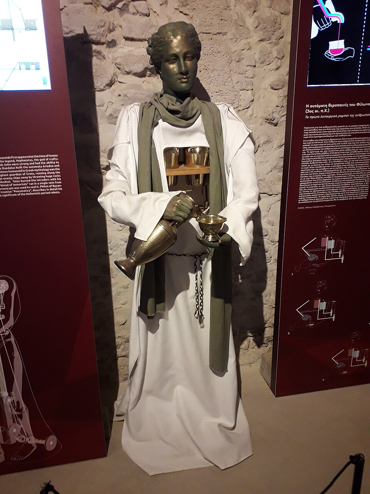{height="440" fig-alt="Replica of the automatic servant of Philon"}
:::
:::

<p class="credits">Replica by Kostas Kotsanas, photo by <a href="https://commons.wikimedia.org/wiki/File:Automatic_servant_of_Philon,_Museum_of_ancient_Greek_technology.jpg">Eunostos</a>, CC BY-SA 4.0.</p>

## The servant of Philon (video)



[If the video does not start: [watch it on YouTube](https://www.youtube.com/watch?v=cK_8KOftT3M)]{.small}

## AI in computer science

Today, "AI" usually means a subfield of **computer science**. The machine is now a computer running a **program**: it takes an input and produces an output.

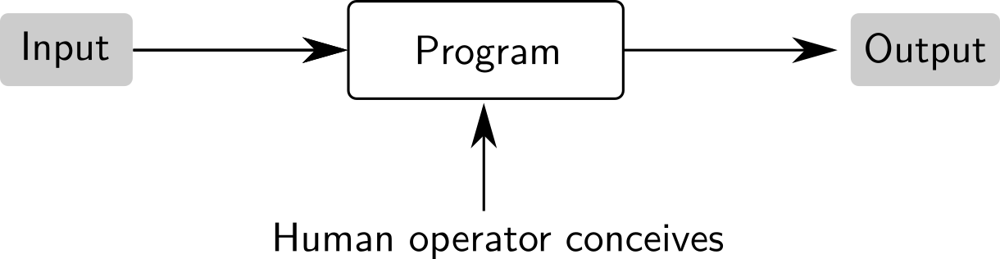{width="80%" fig-alt="Input, program and output; a human operator conceives the program"}

## Algorithm or program?

**An algorithm** is a list of instructions to reach a goal. A cooking recipe is an algorithm! 🧁

```python
def double(numbers):
    return [x * 2 for x in numbers]
```

**A program** is a set of instructions a machine can execute. It may run algorithms, and do other things too.

```python
print("Hello world! Let's double some numbers:")
print(double([1, 2, 3]))
```

## What is machine learning?

Instead of writing the rules, we show **examples** and the program adjusts itself.

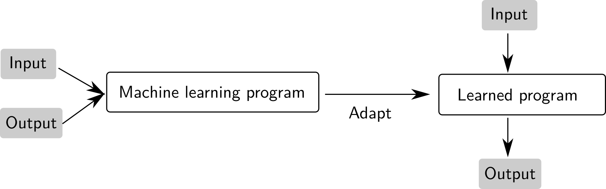{width="85%" fig-alt="A machine learning program uses inputs and outputs to produce a learned program"}

::: {.notes}
Machine learning is a subfield of AI in which models learn from data to make predictions or decisions, without being explicitly programmed for the task.
:::

## Three ways to learn

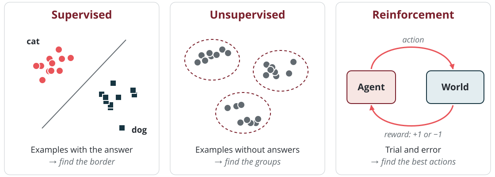{fig-alt="Supervised learning finds a border, unsupervised learning finds groups, reinforcement learning uses rewards"}

## Which approach for which problem?

| | Supervised | Unsupervised | Reinforcement |
|-------|---------|---------|---------|
| **Data** | Examples + answers | Examples only | Rewards from actions |
| **Goal** | Predict the answer | Discover a structure | Choose the best actions |
| **Methods** | Regression, decision trees | K-means, PCA | Q-learning |
| **Examples** | Spam, house prices | Customer groups | Games, robots |

Language models **combine** them: they predict hidden text (*self-supervised*: the text itself is the answer), then learn from good examples, then from rewards.

## AI, machine learning, deep learning

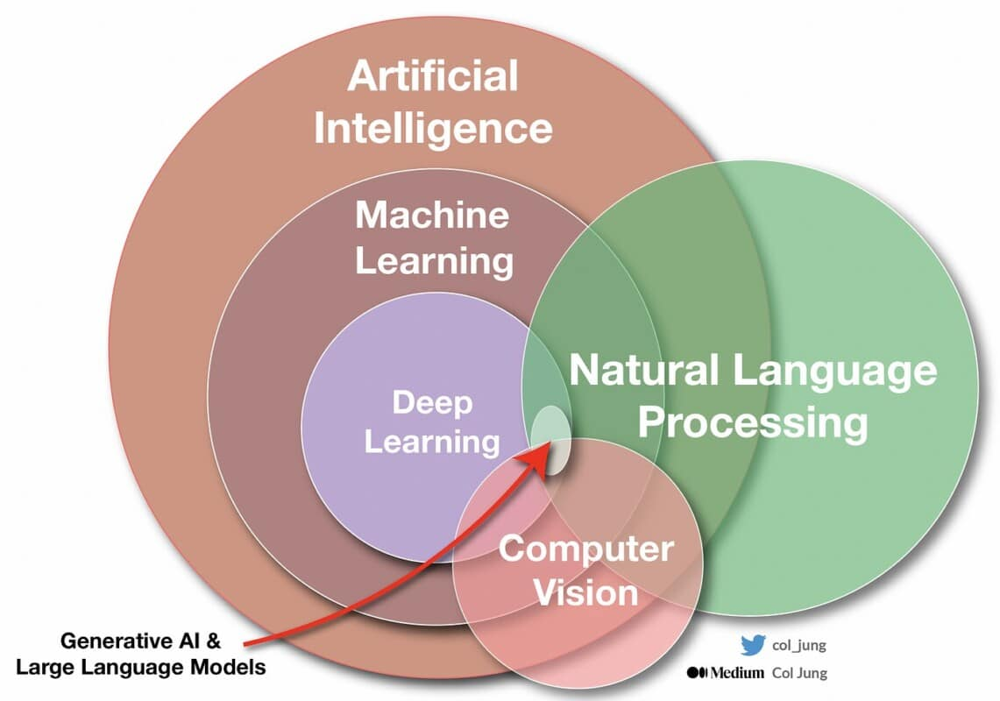{fig-alt="Nested circles: AI contains machine learning, which contains deep learning"}

## An artificial neuron

Multiply by the **weights**, add everything **and the bias**, squeeze. Umbrella?

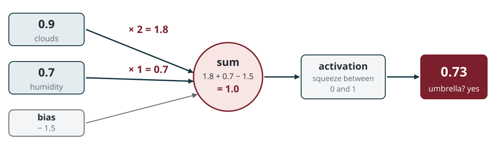{fig-alt="0.9 times 2 plus 0.7 times 1 minus 1.5 gives 1.0, and the activation gives 0.73"}

The weights (2 and 1) and the bias are the **parameters**. Training finds them.

## A network that learns

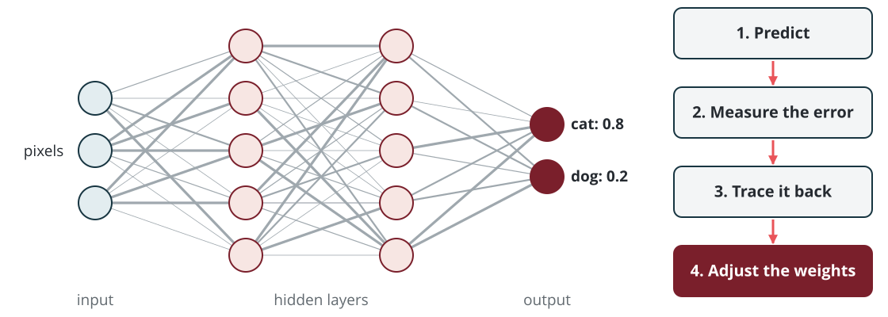{fig-alt="A network with two hidden layers and the four steps of training"}

Step 3 is **backpropagation**. Repeated over millions of examples, it reduces the error little by little. Many hidden layers: this is **deep** learning.

## 2. A short history {.divider background-color="#173541"}

## Six pioneers

AI was not born in 2020. Let's meet six people who made it possible.

::: {.columns .portraits}
::: {.column width="16%"}


**Jacquard**\
1752–1834
:::
::: {.column width="16%"}
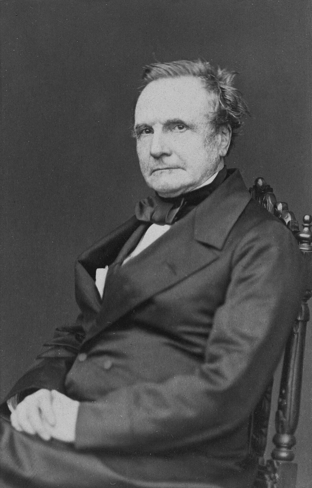

**Babbage**\
1791–1871
:::
::: {.column width="16%"}
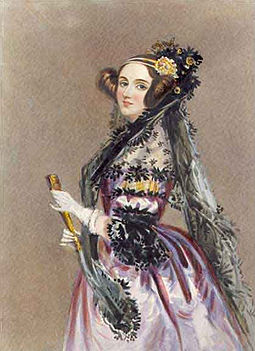

**Lovelace**\
1815–1852
:::
::: {.column width="16%"}
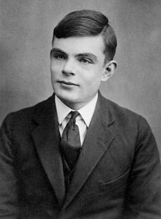

**Turing**\
1912–1954
:::
::: {.column width="16%"}


**Von Neumann**\
1903–1957
:::
::: {.column width="16%"}
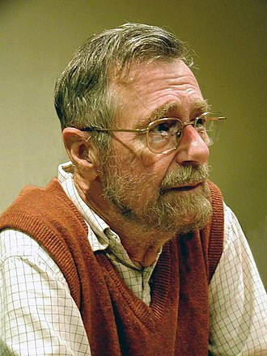

**Dijkstra**\
1930–2002
:::
:::

## Joseph-Marie Jacquard (1752–1834)

In 1804, [Jacquard](https://en.wikipedia.org/wiki/Joseph_Marie_Jacquard) patents a loom **programmed by punched cards**: change the cards, change the pattern.

::: {.columns}
::: {.column width="40%"}
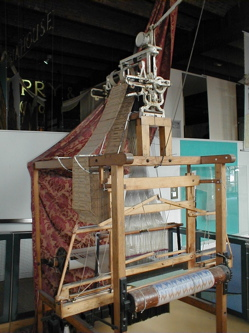{height="390" fig-alt="A Jacquard loom"}
:::
::: {.column width="60%"}
{height="390" fig-alt="The punched cards of a Jacquard loom"}
:::
:::

<p class="credits">Punched cards: photo by <a href="https://commons.wikimedia.org/wiki/File:A_Jacquard_loom_showing_information_punchcards,_National_Museum_of_Scotland.jpg">Stephencdickson</a>, CC BY-SA 4.0.</p>

## Machines and work: the Canuts

The silk weavers of Lyon revolt in **1831** and **1834**. The looms produce more, but the price paid for their work keeps falling.

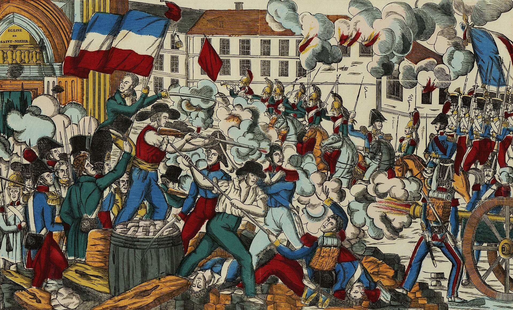{fig-alt="The Canut revolt in Lyon in 1834"}

::: {.notes}
The Canuts are often described as machine breakers. The main demand of 1831 was a guaranteed minimum price (the "tarif"): who benefits from the gains in productivity? The question is still open with AI.
:::

## Charles Babbage (1791–1871)

In 1837, [Babbage](https://en.wikipedia.org/wiki/Charles_Babbage) describes the [Analytical Engine](https://en.wikipedia.org/wiki/Analytical_engine), the first design of a **general-purpose computer**. It was never completed.

::: {.columns}
::: {.column width="40%"}
{height="390" fig-alt="Portrait of Charles Babbage"}
:::
::: {.column width="60%"}
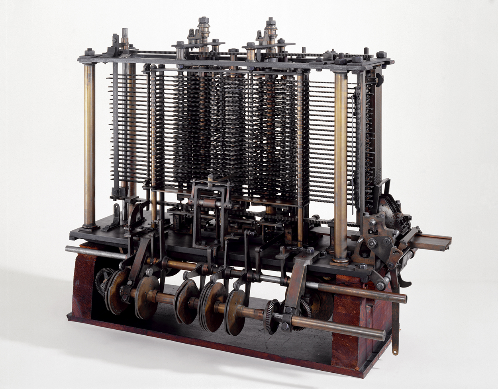{height="390" fig-alt="Trial model of part of the Analytical Engine"}
:::
:::

## Ada Lovelace (1815–1852)

In 1843, [Lovelace](https://en.wikipedia.org/wiki/Ada_Lovelace) publishes "Note G", often considered the **first computer program**: it computes [Bernoulli numbers](https://en.wikipedia.org/wiki/Bernoulli_number).

::: {.columns}
::: {.column width="40%"}
{height="390" fig-alt="Portrait of Ada Lovelace"}
:::
::: {.column width="60%"}
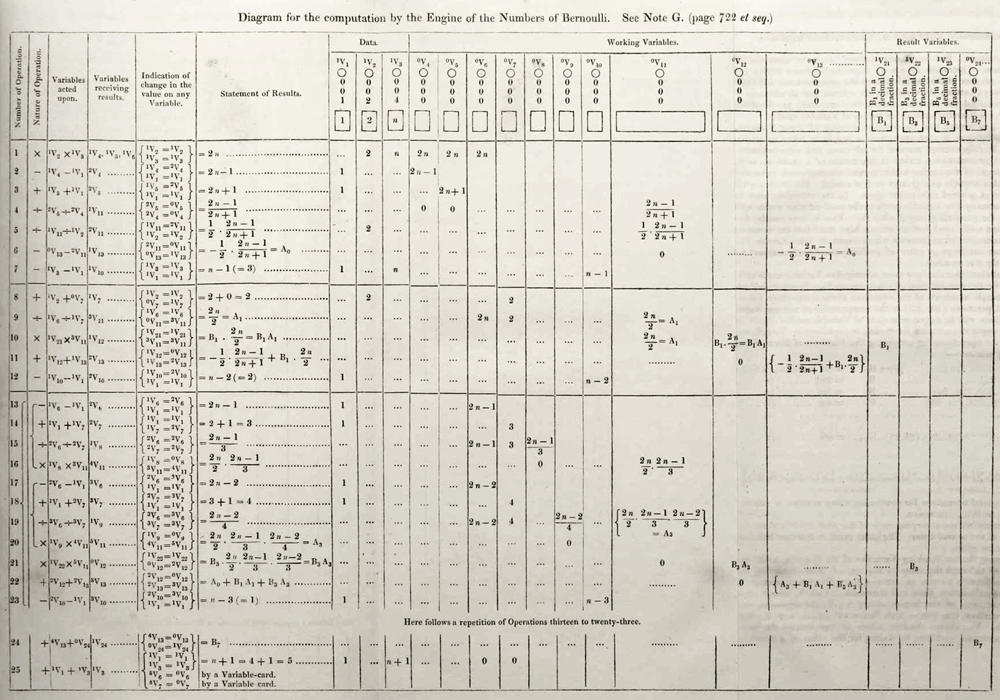{height="390" fig-alt="Diagram of Note G"}
:::
:::

## Alan Turing (1912–1954)

In 1936, [Turing](https://en.wikipedia.org/wiki/Alan_Turing) imagines a **universal machine**, able to run any algorithm. In 1950, he asks: "Can machines think?"

::: {.columns}
::: {.column width="40%"}
{height="390" fig-alt="Portrait of Alan Turing"}
:::
::: {.column width="60%"}
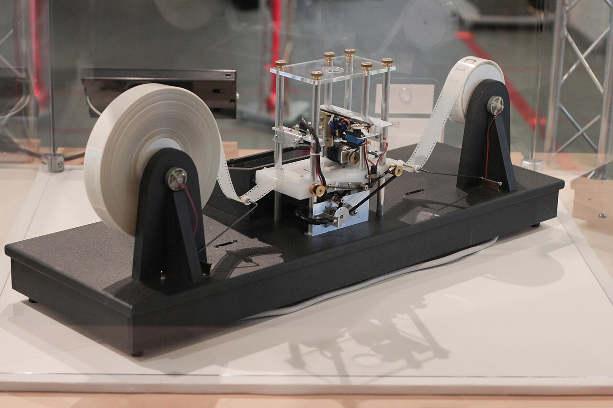{height="390" fig-alt="A physical model of a Turing machine"}
:::
:::

## John von Neumann (1903–1957)

In 1945, [von Neumann](https://en.wikipedia.org/wiki/John_von_Neumann) describes the architecture our computers still use: **program and data share the same memory**.

::: {.columns}
::: {.column width="40%"}
{height="390" fig-alt="Portrait of John von Neumann"}
:::
::: {.column width="60%"}
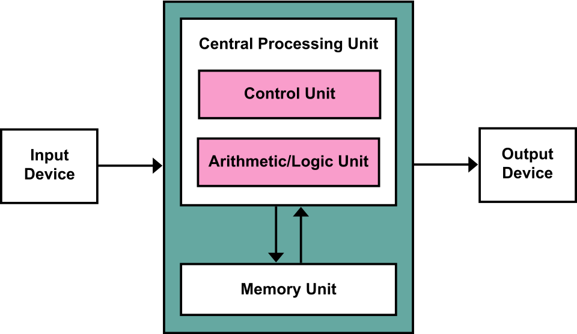{height="340" fig-alt="Von Neumann architecture"}
:::
:::

## Edsger Dijkstra (1930–2002)

In 1956, [Dijkstra](https://en.wikipedia.org/wiki/Edsger_W._Dijkstra) devises his **shortest path algorithm**, published in 1959 and still used everywhere.

::: {.columns}
::: {.column width="40%"}
{height="390" fig-alt="Portrait of Edsger Dijkstra"}
:::
::: {.column width="60%"}
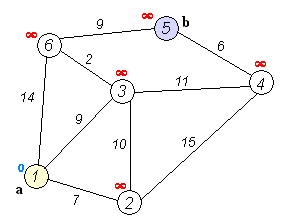{height="340" fig-alt="Animation of the shortest path algorithm"}
:::
:::

## Seventy years in one picture

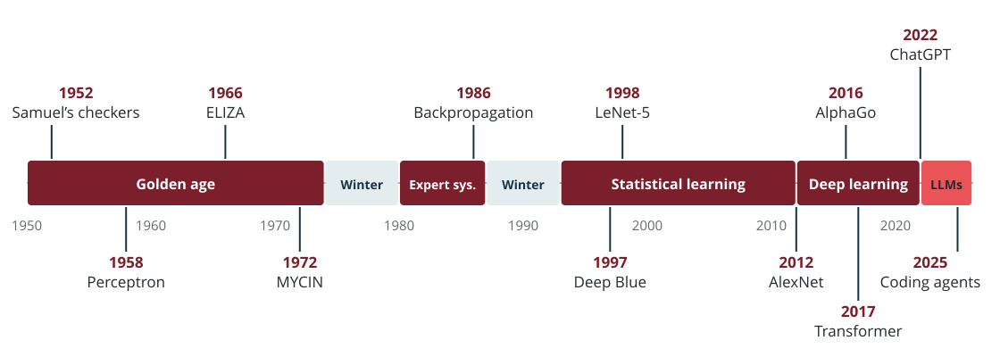{fig-alt="Timeline of AI from 1950 to 2026"}

## Two families of AI

::: {.columns}
::: {.column width="50%"}
**Symbolic AI**

Humans write the rules.

> If it rains, the ground is wet.\
> If the ground is wet, the grass grows.\
> **So** if it rains, the grass grows.

Easy to explain, hard to extend.
:::
::: {.column width="50%"}
**Machine learning**

The machine finds the rules in **data**.

> 10,000 photos of cats\
> 10,000 photos of dogs\
> **So** this new photo is a cat (97%).

Powerful, but harder to explain.
:::
:::

## Symbolic AI in action

::: {.columns}
::: {.column width="64%"}
- [MYCIN](https://en.wikipedia.org/wiki/Mycin) (1970s): hundreds of medical rules to suggest antibiotics
- Expert systems (1980s): the knowledge of specialists turned into rules
- [Deep Blue](https://en.wikipedia.org/wiki/Deep_Blue_(chess_computer)) (1997): beats Garry Kasparov at chess

No learning from examples here: experts and fast computation do the job.
:::
::: {.column width="36%"}
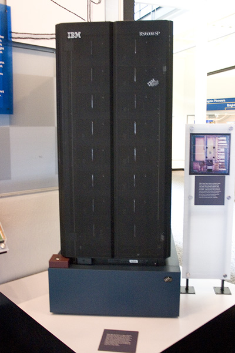{height="430" fig-alt="The IBM Deep Blue computer"}
:::
:::

<p class="credits">Deep Blue, photo by <a href="https://commons.wikimedia.org/wiki/File:Deep_Blue.jpg">James the photographer</a>, CC BY 2.0.</p>

## The first programs that learn

::: {.columns}
::: {.column width="50%"}
**1952**: [Arthur Samuel](https://en.wikipedia.org/wiki/Arthur_Samuel_(computer_scientist)) starts a checkers program that will improve by playing against itself.

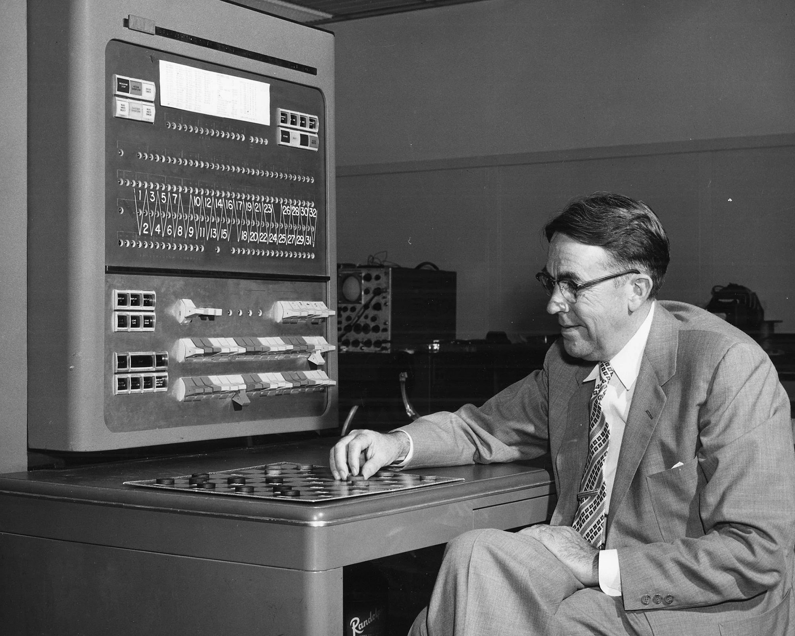{height="330" fig-alt="Arthur Samuel in front of an IBM computer"}
:::
::: {.column width="50%"}
**1958**: [Frank Rosenblatt](https://en.wikipedia.org/wiki/Frank_Rosenblatt) presents the perceptron, ancestor of neural networks.

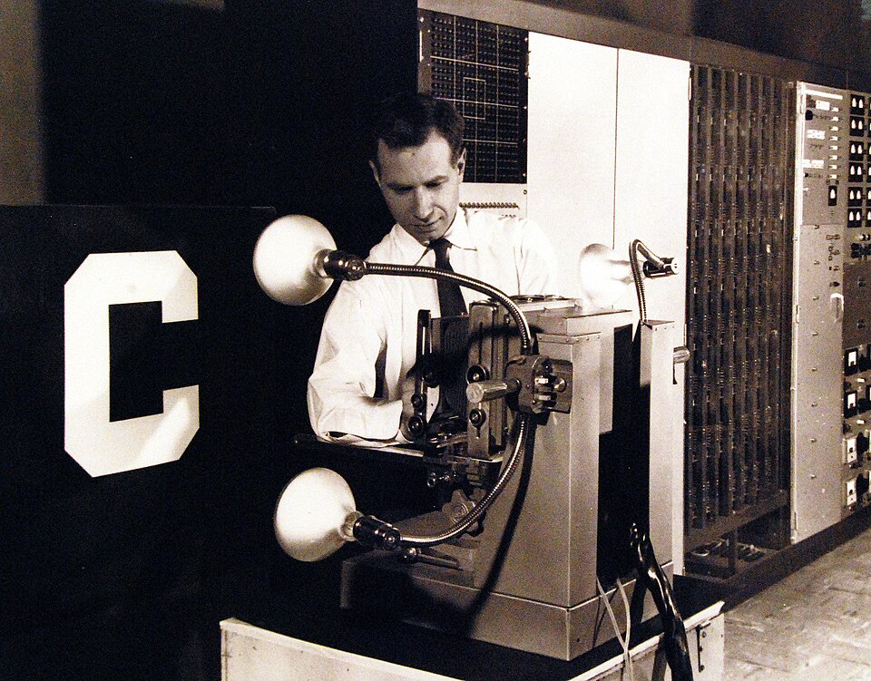{height="330" fig-alt="The Mark I Perceptron learning to recognise the letter C"}
:::
:::

<p class="credits">Mark I Perceptron: <a href="https://commons.wikimedia.org/wiki/File:330-PSA-80-60_(USN_710739)_(20897323365).jpg">National Museum of the U.S. Navy</a>, public domain.</p>

## Promises and winters

"Within a generation, [...] the problem of creating artificial intelligence will substantially be solved" (Marvin Minsky, 1967). Twice, the money stopped.

| Period | What happened |
|----|----------------|
| **1956–1974** | Enthusiasm: the field gets its name and its first successes |
| **1974–1980** | **First winter**: promises not kept, funding cut |
| **1980–1987** | Expert systems: AI enters companies |
| **1987–1993** | **Second winter**: too expensive, too rigid |

Ideas were often right, but **data and computers** were missing.

## 1990s–2000s: learning from data

::: {.columns}
::: {.column width="50%"}
- AI moves from rules to **statistics**
- Simple, analysable models (linear models, SVM)
- First real uses: reading cheques, filtering spam
- Netflix recommends films with *Cinematch* (2000)
:::
::: {.column width="50%"}
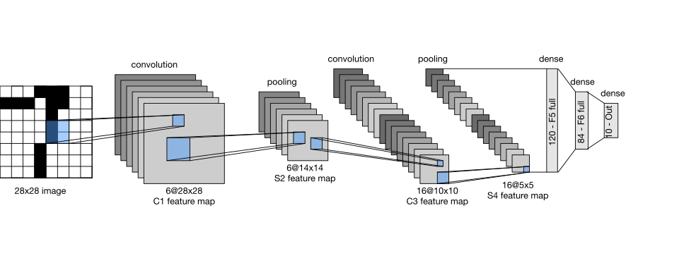{width="100%" fig-alt="The LeNet-5 network"}

[LeNet-5 (1998) reads handwritten digits.]{.small}
:::
:::

<p class="credits">LeNet-5 architecture: Wikimedia Commons.</p>

## 2012: the turning point

A deep neural network, **AlexNet**, wins the [ImageNet](https://en.wikipedia.org/wiki/ImageNet) challenge by a wide margin.

::: {.columns}
::: {.column width="50%"}
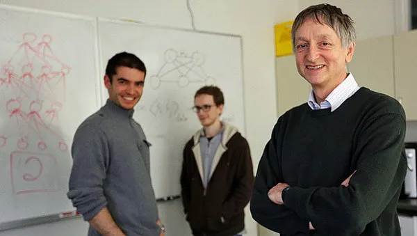{height="290" fig-alt="Ilya Sutskever, Alex Krizhevsky and Geoffrey Hinton"}

[Ilya Sutskever, Alex Krizhevsky and Geoffrey Hinton]{.small}
:::
::: {.column width="50%"}
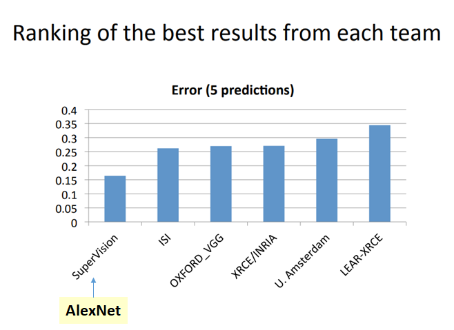{height="340" fig-alt="Error rates of the teams in 2012"}
:::
:::

## Why does deep learning work now?

::: {.columns}
::: {.column width="33%"}
**Large datasets**

Images, text and video from the web

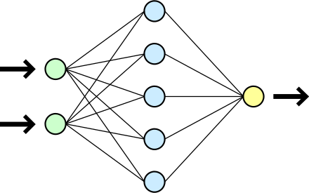{width="85%" fig-alt="A small neural network"}
:::
::: {.column width="33%"}
**Computing power**

GPUs do thousands of operations in parallel

{width="100%" fig-alt="A GPU and a TPU"}
:::
::: {.column width="33%"}
**Software**

Open-source frameworks for everyone

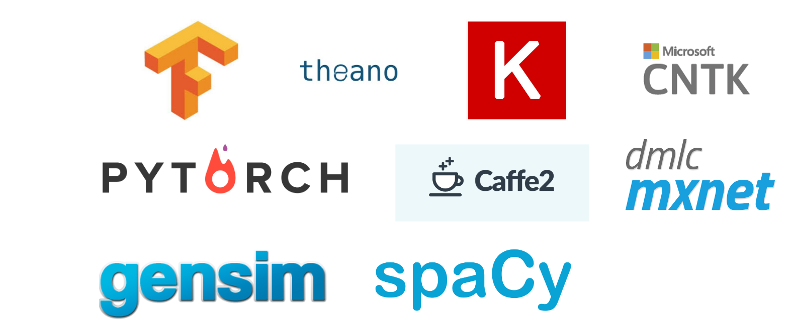{width="100%" fig-alt="Logos of deep learning frameworks"}
:::
:::

## The "godfathers" of deep learning

They kept working on neural networks during the winters, and received the **Turing Award in 2018**.

::: {.columns .center}
::: {.column width="33%"}
{height="330"}

Geoffrey Hinton
:::
::: {.column width="33%"}
{height="330"}

Yann LeCun
:::
::: {.column width="33%"}
{height="330"}

Yoshua Bengio
:::
:::

## Seeing

Classify, detect and segment images: photos, medical scans, roads...

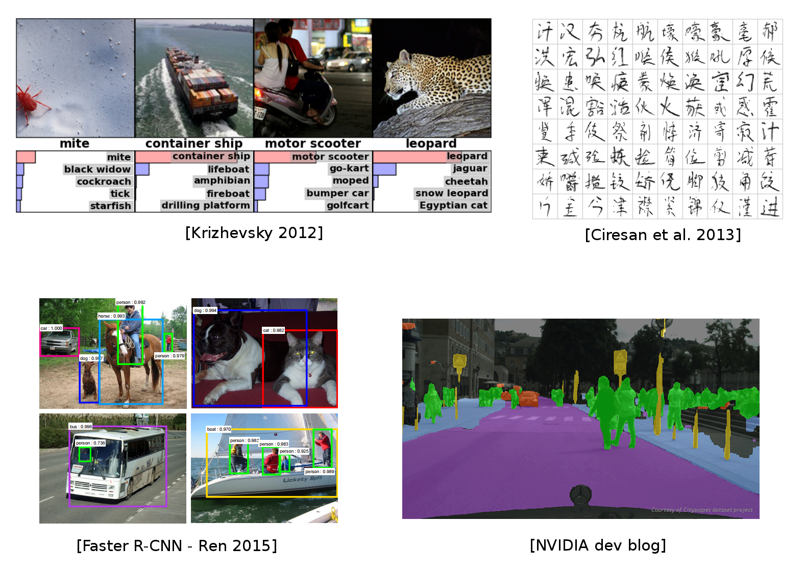{fig-alt="Examples of image classification, detection and segmentation"}

## Creating images

From a sentence to a picture: DALL-E (2021), Imagen, Midjourney and Stable Diffusion (2022).

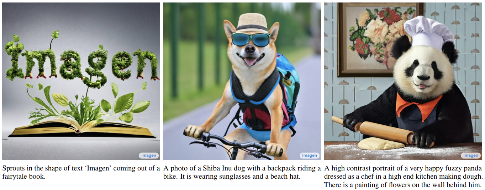{fig-alt="Three images generated by Imagen from text"}

## Speech and sound

::: {.columns}
::: {.column width="45%"}
- **Transcription**: Whisper
- **Voice**: VALL-E, voice assistants
- **Music**: Jukebox, Suno

WaveNet (2016) generates sound one sample at a time. Language models do the same with text!
:::
::: {.column width="55%"}
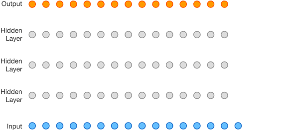{width="100%" fig-alt="Animation of WaveNet"}
:::
:::

## Games

Learning strategies through self-play: AlphaGo, OpenAI Five, MuZero.

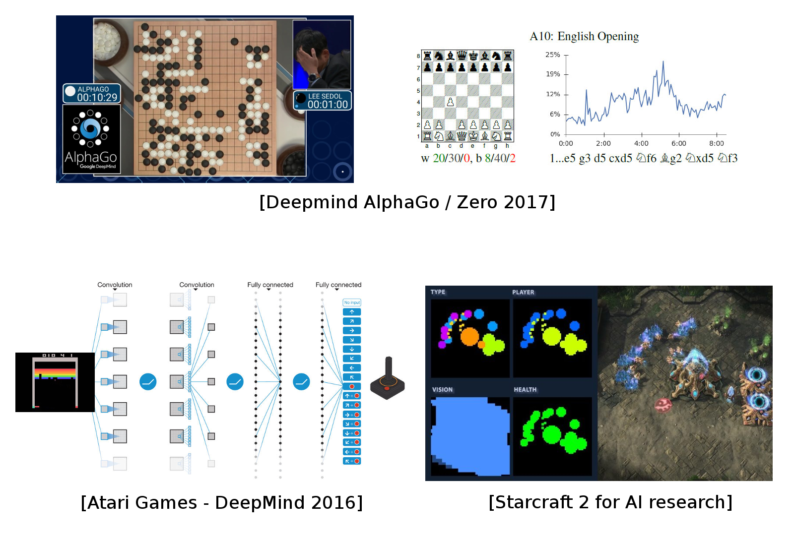{fig-alt="AlphaGo, Atari and StarCraft"}

## Biology

::: {.columns}
::: {.column width="50%"}
**AlphaFold** predicts the 3D structure of proteins from their sequence.

A work of years in the laboratory can take minutes.

Nobel Prize in Chemistry, **2024**.
:::
::: {.column width="50%"}
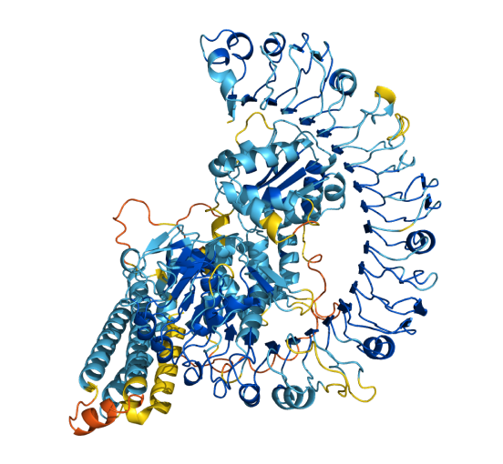{height="430" fig-alt="Protein structure predicted by AlphaFold"}
:::
:::

## Language

| Year | Models | What was new |
|-----|--------|-------------|
| **2017** | Transformer | The architecture: *Attention Is All You Need* |
| **2018–2020** | BERT, T5, GPT-3 | Training on huge amounts of text |
| **2022** | ChatGPT | A conversation anyone can use |
| **2023** | GPT-4, Claude, Llama, Gemini | Competition, open models, images |
| **2024–2025** | o1, DeepSeek-R1 | Models that "think" before answering |
| **2025–2026** | Claude Code, Codex... | **Agents** that act |

## 3. Inside a language model {.divider background-color="#173541"}

## What is an LLM?

::: {.big}
A **Large Language Model** is a program trained to predict **the next piece of text**.
:::

Everything else (chatting, translating, summarising, coding) builds on this ability.

## The big picture

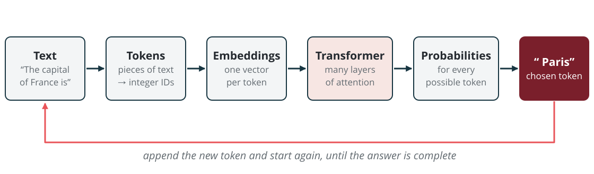{fig-alt="Text, tokens, embeddings, transformer, probabilities, next token, and back"}

We will now open each box.

## Tokens: cutting the text

A model does not read words. It reads **tokens**: whole words, pieces of words, punctuation.

<p class="center" style="font-size:1.1em"><span class="tok">Large<small>4532</small></span><span class="tok">&nbsp;Language<small>982</small></span><span class="tok">&nbsp;Models<small>18273</small></span><span class="tok">&nbsp;are<small>527</small></span><span class="tok">&nbsp;powerful<small>8147</small></span><span class="tok">.<small>13</small></span></p>

Each token has a number (illustrative here). The model only sees the **numbers**.

## Why do tokens matter?

- The **price** of an API is counted in tokens
- The **memory** of a conversation is limited in tokens
- Some **languages** need more tokens than English to say the same thing
- It explains odd mistakes: the model sees chunks, so **counting letters** in a word is hard

## Embeddings: giving meaning to numbers

::: {.columns}
::: {.column width="44%"}
Each token becomes a **vector**: a long list of numbers learned during training.

Related meanings get **nearby vectors**.

A vector is not a dictionary definition: its numbers rarely have a simple meaning.
:::
::: {.column width="56%"}
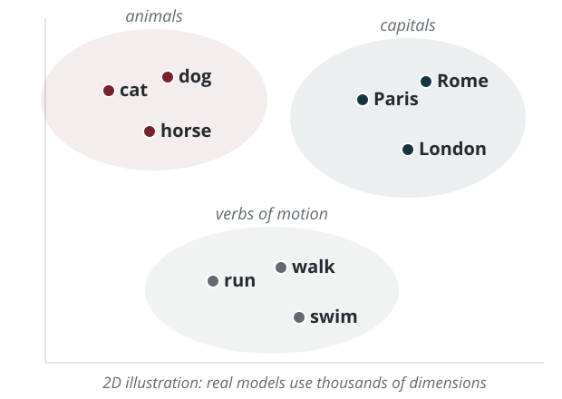{width="100%" fig-alt="Words grouped by meaning"}
:::
:::

::: {.notes}
Example: 50,000 tokens and 4,096 dimensions give a table of 50,000 × 4,096 numbers. A sequence of 3 tokens becomes a 3 × 4,096 matrix.
:::

## Attention: using the context

What does "it" refer to? Each token **looks at the others** to find out.

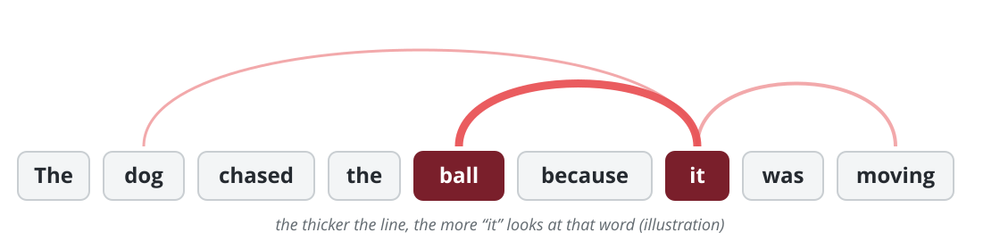{fig-alt="Attention from it to ball"}

Order matters too: *the dog bites the man* is not *the man bites the dog*. The model also encodes the **position** of each token.

## The Transformer

::: {.columns}
::: {.column width="55%"}
- Introduced in 2017 by Google researchers: [*Attention Is All You Need*](https://arxiv.org/abs/1706.03762)
- A stack of **identical blocks**, with different learned values
- GPT-3 has 96 of them
- Computes in parallel, so it **scales** very well
:::
::: {.column width="45%"}
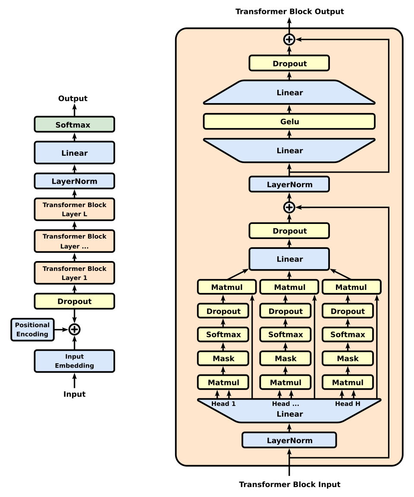{height="470" fig-alt="The architecture of GPT"}
:::
:::

<p class="credits">GPT architecture: Wikimedia Commons.</p>

## What does "7B" mean?

**Parameters** are the numbers adjusted during training. "7B" means 7 billion of them.

| Model | Parameters |
|---|---:|
| FunctionGemma (used in our practical work) | 0.27 billion |
| GPT-3 (2020) | 175 billion |
| Llama 3.1, largest version (2024) | 405 billion |
| DeepSeek-R1 (2025) | 671 billion |
| GPT-4, Claude, Gemini Pro | not published |

**More parameters do not automatically mean better answers.**

::: {.notes}
Weights or parameters? Strictly, a layer computes y = Wx + b: W holds the weights, b the biases, and both are parameters. In everyday use, "weights" often means all of them.
:::

## From scores to probabilities

The model gives a score $z_i$ to **every** token of its vocabulary. *Softmax* turns the scores into probabilities:

$$P(\text{token}_i) = \frac{e^{z_i}}{\sum_j e^{z_j}}$$

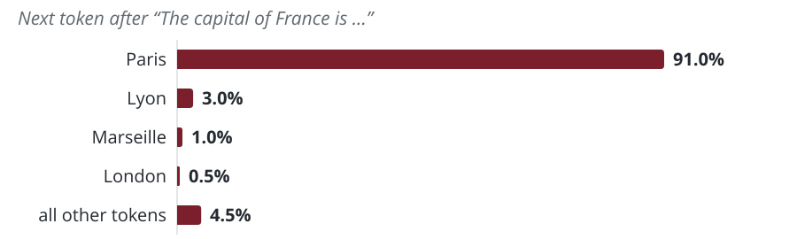{width="75%" fig-alt="Paris 91%, Lyon 3%, Marseille 1%, London 0.5%, others 4.5%"}

## Choosing the next token

| Strategy | Rule |
|---|---|
| **Greedy** | Always take the most probable token |
| **Temperature** | Make the distribution sharper or flatter |
| **Top-k** | Keep only the *k* most probable tokens |
| **Top-p** | Keep the smallest group whose total reaches *p* |

They can be combined. This is why the same question can give **two different answers**.

## Temperature

$$P(\text{token}_i) = \frac{e^{z_i/T}}{\sum_j e^{z_j/T}}$$

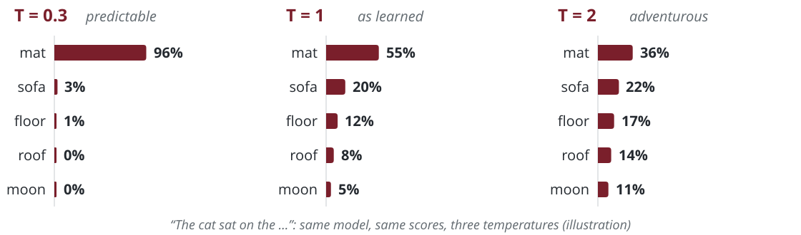{fig-alt="The same distribution at temperature 0.3, 1 and 2"}

## One token at a time

The answer is generated **autoregressively**: each new token is added to the text, then everything starts again.

```text
The capital of France is                →  " Paris"
The capital of France is Paris          →  ","
The capital of France is Paris,         →  " a"
The capital of France is Paris, a       →  " city"
...                                     →  <end>
```

It stops at a special **end token**, or when a length limit is reached.

## The context window

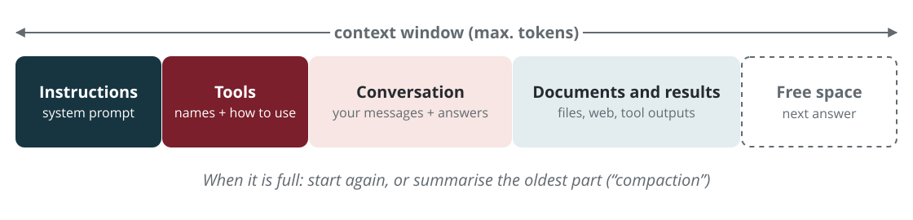{fig-alt="Instructions, tools, conversation, documents and free space"}

In 2020, about 2,000 tokens. In 2026, **1 million** or more. Outside this window, the model sees **nothing**.

The model does not receive the tools themselves, only a **text** that describes each one.

## How is a model trained?

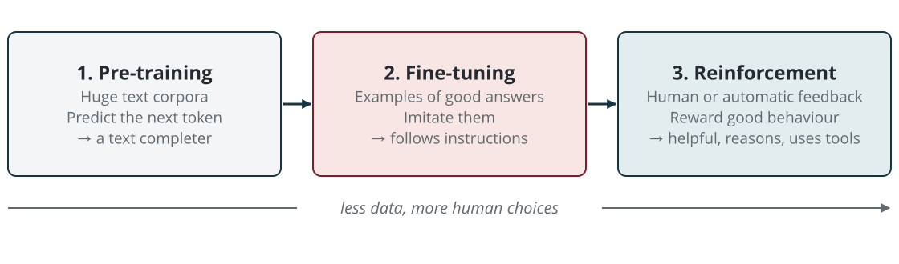{fig-alt="Pre-training, fine-tuning, reinforcement"}

::: {.notes}
Pre-training minimises the next-token prediction error: the loss is minus the sum of the log-probabilities of the right tokens.
:::

## Training or inference?

::: {.columns}
::: {.column width="32%"}
**Training**

- *Changes* the parameters
- Weeks or months
- Thousands of GPUs
:::
::: {.column width="32%"}
**Inference**

- *Uses* the parameters
- A few seconds
- One question at a time
:::
::: {.column width="36%"}
{width="100%" fig-alt="A GPU cluster"}
:::
:::

Talking to ChatGPT, Claude or a local model with Ollama is **inference**: the model does not learn while answering you.

<p class="credits">GPU cluster, photo by <a href="https://commons.wikimedia.org/wiki/File:CSIRO_ScienceImage_11313_The_CSIRO_GPU_cluster_at_the_data_centre.jpg">CSIRO</a>, CC BY 3.0.</p>

## Plausible does not mean true

An LLM can write a **false** sentence as fluently as a true one. This is a *hallucination*.

::: {.columns}
::: {.column width="42%"}
- Invented facts or references
- Knowledge that stops at its **training date**
- **Biases** from the data
- Errors, stated with confidence

**Check** what matters, always.
:::
::: {.column width="58%"}
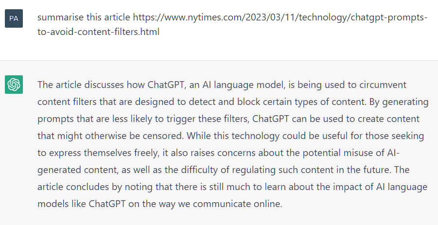{width="100%" fig-alt="ChatGPT summarises a New York Times article from a fake address"}

<p class="credits">The address is <b>fake</b> and ChatGPT had no internet access: it invented everything. <a href="https://commons.wikimedia.org/wiki/File:ChatGPT_hallucination.png">Wikimedia Commons</a>, public domain.</p>
:::
:::

## Try it yourself

Open a language model in your browser and look inside:

::: {.big}
[LLM Explorer](https://chyams-llm-explorer.hf.space/)
:::

Find a sentence where the second most probable token would change the whole story.

## 4. From chatbot to agent {.divider background-color="#173541"}

## Four years of change

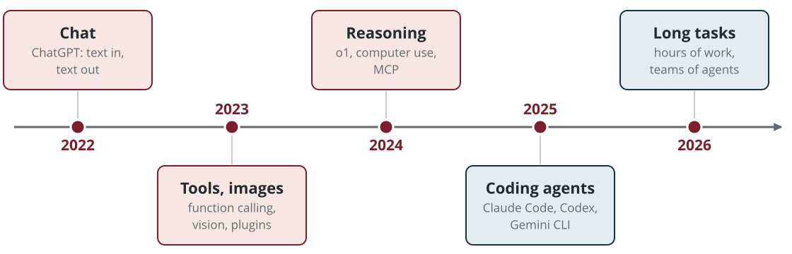{fig-alt="2022 chat, 2023 tools and images, 2024 reasoning, 2025 coding agents, 2026 long tasks"}

In November 2022, ChatGPT could only produce text. It had no web access, no files, no tools.

## An old dream

::: {.columns}
::: {.column width="62%"}
**Shakey** (1966–1972) was the first mobile robot able to reason about its own actions:

- **perceive** the room with a camera
- **plan** a route
- **act**, then look again

Today's agents follow the same loop, with a language model as the planner.
:::
::: {.column width="38%"}
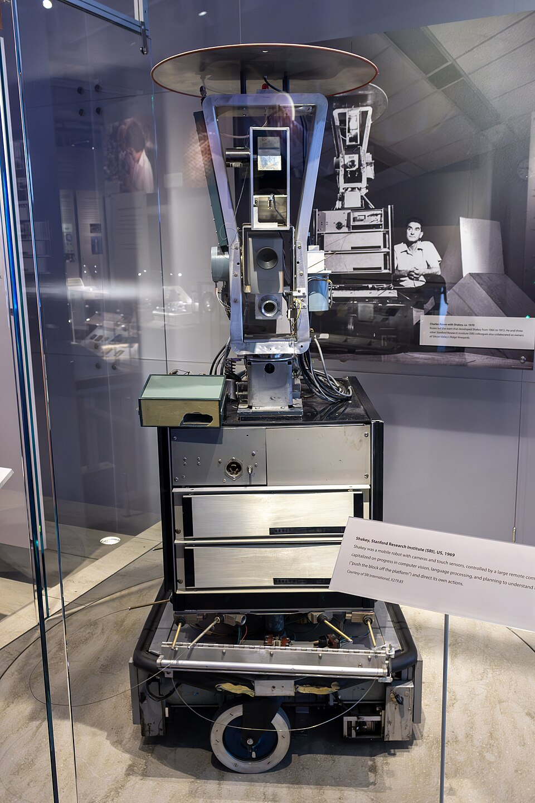{height="460" fig-alt="Shakey the robot"}
:::
:::

<p class="credits">Shakey, photo by <a href="https://commons.wikimedia.org/wiki/File:SRI_Shakey_robot,_1969,_Computer_History_Museum.jpg">The wub</a>, CC BY-SA 4.0.</p>

## Chatbot or agent?

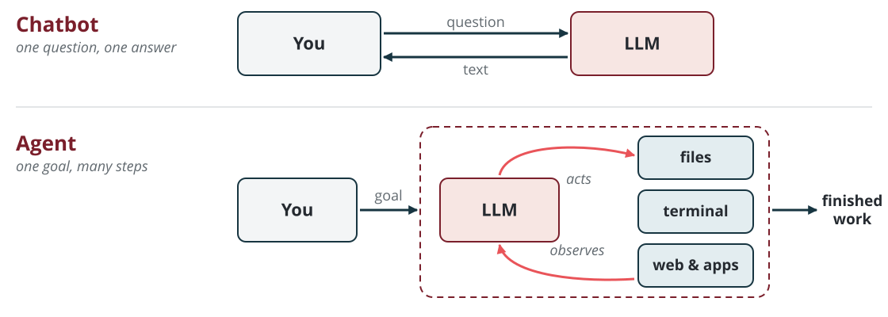{fig-alt="A chatbot answers a question, an agent acts in a loop with tools"}

## What is an agent?

::: {.big}
Agents are "typically just **LLMs** using **tools** based on **environmental feedback** in a **loop**."
:::

<p class="credits center">Anthropic, <a href="https://www.anthropic.com/engineering/building-effective-agents">Building effective agents</a> (2024)</p>

## The loop

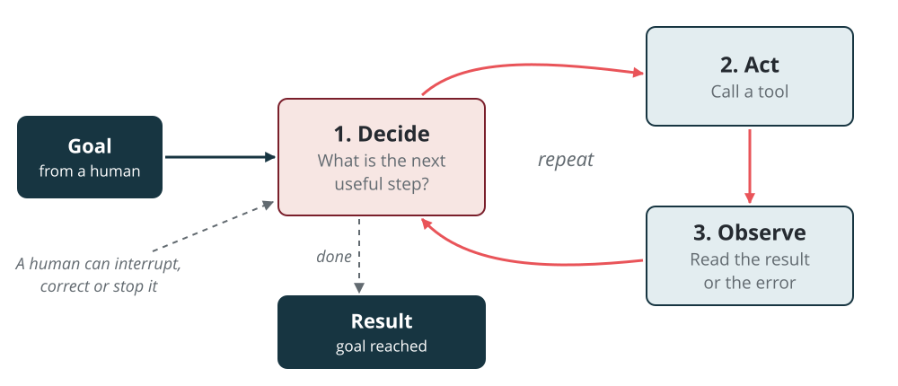{fig-alt="Goal, decide, act, observe, repeat, result"}

## The loop, in code

```python
messages = [goal]

for step in range(MAX_STEPS):             # never loop forever
    answer = llm(messages, tools)         # 1. decide
    messages.append(answer)

    if not answer.tool_calls:             # nothing left to do
        break

    for call in answer.tool_calls:
        if is_allowed(call):              # permissions
            result = run(call)            # 2. act
        else:
            result = "Refused by the user"
        messages.append(result)           # 3. observe
```

`answer.tool_calls` is the list of tools the model **asks** to use, for example `read_file("notes.txt")`. Empty list: it has finished.

## Model + harness = agent

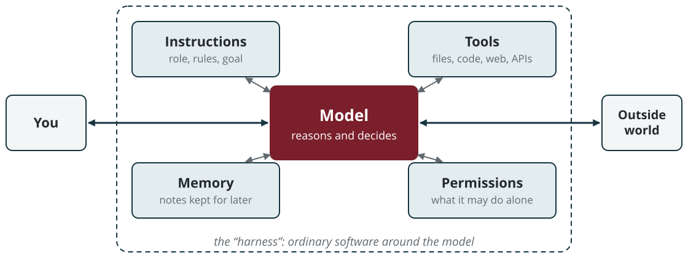{fig-alt="The model in the centre, with instructions, tools, memory and permissions"}

You can change the **model** and keep the same **harness**.

## Tools: the model asks, the software acts

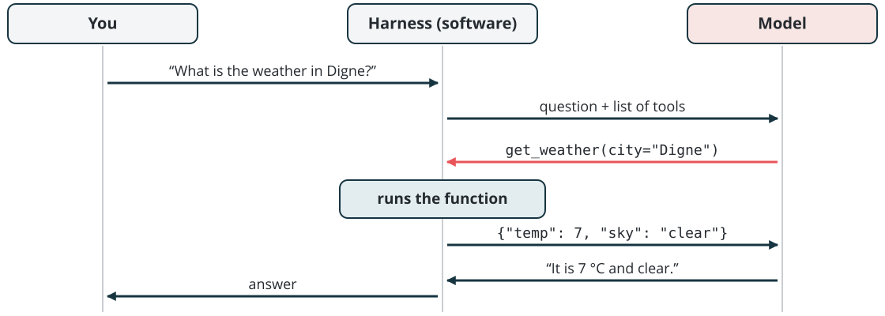{fig-alt="Sequence of a tool call between you, the harness and the model"}

The model **never** runs anything itself. It writes a request; the harness decides.

## Memory

Between two requests, an LLM remembers **nothing**. The harness creates the illusion of memory.

| Kind | How it works |
|----|----------------|
| **Short term** | The whole conversation is sent again at each step |
| **Compaction** | Old messages are replaced by a summary |
| **Long term** | The agent writes notes in files, and reads them later |
| **RAG** | Relevant documents are searched and added to the prompt |

## More than text

A **multimodal** model also understands other kinds of data:

- **Images**: read a chart, a photo, a screenshot
- **Documents**: PDF files, tables, scanned pages
- **Audio and video**: listen, transcribe, describe

For an agent, this means **seeing** the screen and checking its own work.

## MCP: a shared plug for tools

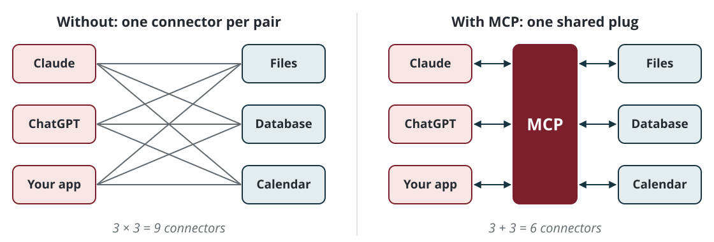{fig-alt="Without MCP nine connectors, with MCP six"}

## The Model Context Protocol

::: {.columns}
::: {.column width="70%"}
- Open standard published by Anthropic in **November 2024**
- Connects AI applications to tools and data, as USB connects devices
- Adopted by OpenAI, Google, Microsoft...
- Since **December 2025**, hosted by the [Linux Foundation](https://blog.modelcontextprotocol.io/posts/2025-12-09-mcp-joins-agentic-ai-foundation/)
:::
::: {.column width="30%"}
{width="80%" fig-alt="MCP logo"}
:::
:::

## MCP: what does it look like?

Text messages in **JSON**, sent to a local program or over HTTP.

::: {.columns .mcp}
::: {.column width="50%"}
**1. What can you do?**

```json
{ "jsonrpc": "2.0", "id": 1,
  "method": "tools/list" }
```

The server answers:

```json
{ "jsonrpc": "2.0", "id": 1,
  "result": { "tools": [ {
    "name": "weather_current",
    "description": "Weather for a place",
    "inputSchema": {
      "type": "object",
      "properties": {
        "location": {"type": "string"} }
    } } ] } }
```
:::
::: {.column width="50%"}
**2. Do it, please**

```json
{ "jsonrpc": "2.0", "id": 2,
  "method": "tools/call",
  "params": {
    "name": "weather_current",
    "arguments": {"location": "Paris"} } }
```

The server answers:

```json
{ "jsonrpc": "2.0", "id": 2,
  "result": { "content": [ {
    "type": "text",
    "text": "Paris: 12 °C, light rain"
  } ] } }
```
:::
:::

<p class="credits">Simplified from the <a href="https://modelcontextprotocol.io/docs/learn/architecture">MCP documentation</a>: version and cache fields are omitted.</p>

## Is MCP safe?

MCP is a protocol, like HTTP. It is neither safe nor dangerous by itself.

**It depends on:**

- the **server** you install: do you trust its author?
- the **rights** you give it: read only, or write too?
- the **confirmation** asked before sensitive actions

Connecting a server means giving **someone's code** access to your data.

## Levels of autonomy

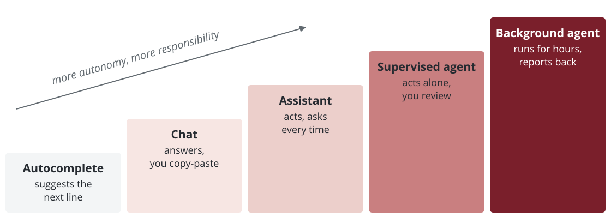{fig-alt="From autocomplete to background agent"}

## 5. Coding with AI {.divider background-color="#173541"}

## Vibe coding

::: {.columns}
::: {.column width="68%"}
The term was coined by [Andrej Karpathy](https://en.wikipedia.org/wiki/Andrej_Karpathy) in February 2025.

You describe what you want in plain language, accept the code, and **hardly read it**.

It is different from a developer who uses AI **and reviews** the result.
:::
::: {.column width="32%"}
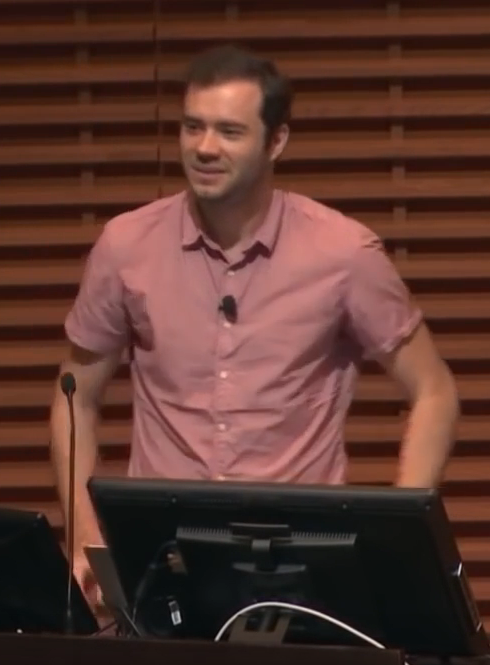{height="400" fig-alt="Andrej Karpathy"}
:::
:::

<p class="credits">Andrej Karpathy, by <a href="https://commons.wikimedia.org/wiki/File:Andrej_Karpathy,_OpenAI.png">Gladwin Analytics</a>, CC BY 3.0.</p>

## What AI brings

::: {.columns}
::: {.column width="50%"}
**For developers**

- Repetitive code written faster
- Help with a new language
- Help to find bugs
- More time for design
:::
::: {.column width="50%"}
**For everyone**

- A prototype without being a developer
- Projects that were too expensive
- Explanations on demand
:::
:::

## What can go wrong

| Risk | Example |
|---|---|
| **Security** | Flaws, or a library that does not exist |
| **Maintenance** | Code nobody understands |
| **Performance** | It works, but slowly |
| **Architecture** | Everything in one file, duplicated |
| **Legal** | Copied code, unknown licence |

## "Zero hand written code"

::: {.columns}
::: {.column width="50%"}
{.nostretch width="86%" fig-alt="Post of 15 March 2025: my saas was built with Cursor, zero hand written code"}

{.nostretch width="86%" fig-alt="Post of 16 March 2025: I just vibe coded my way out of a cyber attack"}
:::
::: {.column width="50%"}
{.nostretch width="78%" fig-alt="Post of 16 March 2025: someone is trying to find security vulnerabilities in my app"}
:::
:::

<p class="credits">March 2025. Original posts: <a href="https://x.com/leojr94_/status/1900767509621674109">1</a>, <a href="https://x.com/leojr94_/status/1901132000871731401">2</a>, <a href="https://x.com/leojr94_/status/1901183590744158487">3</a>.</p>

## Five days later

::: {.columns}
::: {.column width="50%"}
{width="100%" fig-alt="Post of 17 March 2025: guys, I'm under attack"}
:::
::: {.column width="50%"}
{width="100%" fig-alt="Post of 20 March 2025: I'm shutting down my app"}
:::
:::

Used-up API keys, a bypassed subscription, junk in the database. The problem was not AI, but **nobody understood the code**.

<p class="credits">Original posts: <a href="https://x.com/leojr94_/status/1901560276488511759">4</a>, <a href="https://x.com/leojr94_/status/1902537756674318347">5</a>. Found through <a href="https://ludditus.com/2025/03/26/not-everyone-is-dumb/">Not everyone is dumb regarding AI</a>.</p>

## Prototype or product?

::: {.columns}
::: {.column width="50%"}
**A prototype** ✅

Vibe coding is a good way to test an idea, or to make a small tool for yourself.
:::
::: {.column width="50%"}
**A product** ⚠️

Users, personal data, payments: somebody must **understand** the code.
:::
:::

## 6. The impact of AI {.divider background-color="#173541"}

## Work

::: {.columns}
::: {.column width="66%"}
- Earlier revolutions automated **manual** tasks; this one reaches **intellectual** work
- Some jobs disappear, others appear, most **change**
- Remember the Canuts: who benefits?
:::
::: {.column width="34%"}
{.nostretch height="190" fig-alt="The Canut revolt"}
:::
:::

**What do the 2026 studies say?**

- [Stanford](https://digitaleconomy.stanford.edu/news/canariesaug26/): no general job loss, but a **19% gap** for ages 22–25 in exposed jobs (cause not proven)
- [OECD](https://www.journaldunet.com/business/1552481-l-ocde-affirme-que-l-intelligence-artificielle-ne-provoque-pas-de-baisse-generalisee-de-l-emploi-dans-ses-pays-membres-selon-son-rapport-2026/) (in French): AI is reshaping work, not reducing it
- [French Treasury](https://www.tresor.economie.gouv.fr/Articles/2026/06/30/l-intelligence-artificielle-quels-effets-sur-l-emploi) (in French): total effect still **uncertain**

## From labour to capital?

If machines do more of the work, income may move:

::: {.columns}
::: {.column width="50%"}
{width="100%" fig-alt="Workers in an iron rolling mill, painting by Menzel"}

**from labour**: people paid for their time and skills
:::
::: {.column width="50%"}
{width="100%" fig-alt="A row of server racks and nobody in the room"}

**to capital**: owners of models, data and computers
:::
:::

Will some be left behind? How should the gains be **shared**?

<p class="credits">Adolph Menzel, <a href="https://commons.wikimedia.org/wiki/File:Adolph_Menzel_-_Eisenwalzwerk_-_Google_Art_Project.jpg">The Iron Rolling Mill</a>, 1872–1875. <a href="https://commons.wikimedia.org/wiki/File:Datacenter_Server_Racks_(22370909788).jpg">Server racks</a>, Carl Lender, CC BY 2.0. Both cropped.</p>


## Security and privacy

::: {.columns}
::: {.column width="50%"}
**Defence**

- Find flaws before attackers do
- Read and fix old code
- Watch a network day and night
:::
::: {.column width="50%"}
**Attack**

- Find the same flaws
- Credible phishing in any language
- Deepfakes of voices and faces
:::
:::

And what you send to an online model **leaves your computer**. Never share a password or personal data without authorisation.

## Sovereignty and control

Private investment in AI in 2025:

{width="90%" fig-alt="United States 285.9, Europe 20.9, China 12.4 billion dollars"}

The most powerful models belong to a few companies, mostly American. Alternatives: **Mistral** in Europe, **open-weight** models such as DeepSeek or Qwen in China.

<p class="credits"><a href="https://hai.stanford.edu/ai-index/2026-ai-index-report/economy">Stanford AI Index 2026</a>. Chinese public funding is not included.</p>

## Europe: how much public money?

Nobody publishes a **complete total**. What we know:

| | Amount | But... |
|-------|-------|--------------|
| **InvestAI** (2025) | €200 billion | A target, mostly private money |
| **AI gigafactories** (2026) | up to €10 billion | EU + states; more than €20 billion private expected |
| **Already available** | about €1 billion | The rest depends on the 2028+ EU budget |
| **Public contracts** (2013–2024) | $3.7 billion | UK included, research grants excluded |

For comparison, the United States: **$20.4 billion** (2013–2024), grants **included**.

<p class="credits"><a href="https://digital-strategy.ec.europa.eu/en/news/eu-launches-ai-gigafactories-call-boost-europes-computing-capacity-and-unlock-more-eu30-billion">European Commission</a> and <a href="https://www.euronews.com/2026/07/30/eu-opens-call-for-seven-gigafactories-to-train-next-generation-ai-technologies">Euronews</a> (July 2026); <a href="https://openfuture.eu/our-work/steering-ai-investment/">Open Future</a>; <a href="https://hai.stanford.edu/assets/files/ai_index_report_2026_chapter_8_policy_and_governance.pdf">AI Index 2026, ch. 8</a>.</p>

## 7. A new era? {.divider background-color="#173541"}

## Mathematics: 722 papers in one day

::: {.columns}
::: {.column width="62%"}
On **6 October 2026**, OpenAI [releases 722 manuscripts](https://en.wikipedia.org/wiki/OpenAI_bulk_release_of_mathematical_papers) written by a model.

- About half come with a computer-checked proof
- 3 were withdrawn within a day, 14 were revised

Fields medallist **Hugo Duminil-Copin**: "They have annihilated my field of research."
:::
::: {.column width="38%"}
{width="100%" fig-alt="Hugo Duminil-Copin in 2014"}
:::
:::

**What is a proof for: being true, or being understood?**

<p class="credits">Hugo Duminil-Copin in 2014, photo by <a href="https://commons.wikimedia.org/wiki/File:Hugo_Duminil-Copin_in_Oberwolfach.jpg">Tatjana Ruf</a>, CC BY-SA 2.5.</p>

## Research without researchers?

Agents can read papers, write code, run experiments and draft results.

::: {.columns}
::: {.column width="50%"}
**Hopes**

- Faster discoveries
- Testing many more ideas
- Help for small teams
:::
::: {.column width="50%"}
**Concerns**

- Too many results to verify
- Who is responsible for an error?
- How do we train young researchers?
:::
:::

## A question from 1859

::: {.columns}
::: {.column width="20%"}
{height="215" fig-alt="Portrait of Bernhard Riemann"}
:::
::: {.column width="80%"}
Prime numbers (2, 3, 5, 7, 11...) seem to appear at random. **Bernhard Riemann** links them to the zeros of a function, ζ.

**His hypothesis:** all the non-trivial zeros lie on **one line**.

$$\zeta(s) = 0 \;\text{ and }\; s \notin \{-2, -4, -6, \dots\} \;\Rightarrow\; \operatorname{Re}(s) = \tfrac{1}{2}$$
:::
:::

{width="95%" fig-alt="The zeta function on the critical line and its first ten zeros"}

::: {.notes}
One of the seven Millennium Problems of the Clay Institute (one million dollars each). The curve was computed for this slide. Seeing ten zeros, or ten billion, on the line proves nothing about all of them.
:::

## 20 November 2026

::: {.columns}
::: {.column width="64%"}
**Levent Alpöge**, a mathematician at Anthropic, publishes a proof found with an **unreleased Claude model**.

- **17 million** lines of Lean, in 175,187 files
- **Six weeks** of work in October and November
- Covers a **generalised** version (Dirichlet)
- For human readers: a **4-page** note
:::
::: {.column width="36%"}
{width="100%" fig-alt="Levent Alpöge in 2024"}
:::
:::

Same day: a proof "with no AI" by Alessandro Masullo, **not verified**.

<p class="credits"><a href="https://en.wikipedia.org/wiki/Alp%C3%B6ge's_proof_of_the_Riemann_hypothesis">Wikipedia</a>, <a href="https://www.scientificamerican.com/article/dueling-claims-of-riemann-hypothesis-proofs-emerge/">Scientific American</a>. Levent Alpöge in 2024, photo by <a href="https://commons.wikimedia.org/wiki/File:Levent_Alp%C3%B6ge_2024_MFO.jpg">Marlene Ruf</a>, CC BY-SA 2.0 DE.</p>


## Is it true?

**Lean** is a language in which a computer checks **every step** of a proof.

| Question | Answer |
|---|---|
| Is it really Riemann's statement? | Yes: the definition of the public library Mathlib |
| Does the code compile? | Yes: rebuilt dozens of times by volunteers |
| Was the statement changed on the way? | No: verified by comparison tools |
| Do independent checkers agree? | Yes |

"We have full confidence that Alpöge's proof [...] is correct." ([Lean FRO and Mathlib Initiative](https://leanprover-community.github.io/blog/posts/riemann-hypothesis/), 21 November)

## Is it understood?

**Not yet.** On 24 November, there is no complete proof readable by humans.

- Two mathematicians, helped by AI, published **summaries**. One is a 265-page draft that still leaves key steps unproved
- Terence Tao: "the digestion process will take **some time**"
- The Association for Human Mathematics contests its **value**: no human can answer for it
- The Clay Institute now lists the problem as **"active"**, not solved

A machine can tell us **that** it is true, without telling us **why**.

<p class="credits"><a href="https://terrytao.wordpress.com/">Terence Tao's blog</a>, <a href="https://www.math.uwaterloo.ca/~mrubinst/alpoge_claude_grh/">Michael Rubinstein</a>, <a href="https://www.sciencenews.org/article/riemann-hypothesis-solved-math-ai">Science News</a>, The Next Web.</p>

## What does it change?

| Area | Consequence |
|----|----------------|
| **Mathematics** | Hundreds of results "true if Riemann is true" gain a foundation |
| **Cryptography** | Codes are **not** broken: most experts already assumed it was true |
| **Publishing** | Who reviews 17 million lines? Who is the author? |
| **Researchers** | Less "is it true?", more "what does it mean?" |
| **Power** | The model is private, and belongs to a company |

The announcement came one day after Anthropic's **IPO**: the mathematics can be checked, the publicity must be **questioned**.

## Has the machine overtaken us?

::: {.columns}
::: {.column width="50%"}
**Yes, at some tasks**

- Combining "all number theory produced in the last 50 years" (F. Nuccio)
- Writing and checking millions of steps
- Never getting tired
:::
::: {.column width="50%"}
**No, not on its own**

- A specialist chose the problem and steered the model
- Humans created the theories it used
- Humans decide what **matters**
:::
:::

"A very skilled AI **jockey** riding a very fast AI **horse**." (Steven Strogatz)

<p class="credits">Quotes: <a href="https://en.wikipedia.org/wiki/Alp%C3%B6ge's_proof_of_the_Riemann_hypothesis">Wikipedia</a>, from Quanta and other press articles.</p>

## Recursive self-improvement

An AI "fully autonomously designing and developing **its own successor**".

{fig-alt="A model does research, trains a better model, and so on"}

In 1965, I. J. Good already imagined an "intelligence explosion". It has **not been demonstrated** today.

<p class="credits">Definition: <a href="https://www.anthropic.com/institute/recursive-self-improvement">Anthropic, When AI builds itself</a> (2026).</p>

## Is it happening?

::: {.columns}
::: {.column width="50%"}
**Signs that it starts**

- Over **80%** of new code at Anthropic was written by Claude (May 2026)
- Progress there is about **1.9×** faster than before on well-defined tasks (METR estimate)
- Anthropic says it reached its threshold for automated research, counting **future** models
:::
::: {.column width="50%"}
**Reasons to doubt**

- "Not clearly accelerated on **public** measures"
- Humans "still supply most of the research **judgment**"
- Chips and energy do not improve themselves
- The best figures come from the **companies**
:::
:::

<p class="credits"><a href="https://forecastingresearch.org/research/recursive-self-improvement-v1">Forecasting Research Institute</a>, review of 24 November 2026; Anthropic (2026).</p>

## Beyond our understanding?

{fig-alt="Computer proofs from 1976 to 2026"}

We already trust proofs that nobody has read in full. What is new: the **ideas** may come from the machine too.

It is not inevitable. We can require explanations, or stop what nobody can explain ([comprehension audits](https://arxiv.org/abs/2610.10064)).

## A new era? Your turn

1. Would you accept a **medicine** that works, if nobody understands why?
2. Who deserves the **prize**: the mathematician, the model, the company, or the authors of 50 years of number theory?
3. Should we keep **learning** what a machine does better than us?
4. Who should have the right to **stop** an AI that improves itself?


## Credits

This slideshow was created by [virgilus](https://github.com/virgilus) using [Quarto](https://quarto.org). It was inspired by the lectures of the [Data Science and Machine Learning](https://github.com/data-psl/lectures2025) program, by Arthur Mensch, Zaccharie Ramzi and Hugo Richard.

Boxed diagrams and charts were made for this deck. Other images come from Wikimedia Commons and from course resources; they are credited on their slide when the source is known.

## References

- Vaswani et al., [Attention Is All You Need](https://arxiv.org/abs/1706.03762) (2017)
- Anthropic, [Building effective agents](https://www.anthropic.com/engineering/building-effective-agents) (2024)
- MCP, [Official website](https://modelcontextprotocol.io)
- Lean FRO and Mathlib, [Lean verification of the Riemann Hypothesis](https://leanprover-community.github.io/blog/posts/riemann-hypothesis/) (2026)
- Forecasting Research Institute, [How close is recursive self-improvement?](https://forecastingresearch.org/research/recursive-self-improvement-v1) (2026)
- Stanford HAI, [AI Index 2026](https://hai.stanford.edu/ai-index/2026-ai-index-report)
